# Task Planner — instrukcja użytkownika

Aplikacja web · listopad 2026

Task Planner to codzienny planer zadań: listy i projekty, tablica kanban, kalendarz z blokami czasu, oś czasu, karteczki, zadania cykliczne, tryb skupienia i przeglądy. Wszystkie dane masz w przeglądarce, więc aplikacja działa szybko i **bez sieci** — zmiany wysyłają się same, gdy wróci połączenie.

> **O zrzutach ekranu.** Wszystkie pochodzą z przykładowego konta. Osoby, firmy, adresy i zadania są zmyślone.

## Spis treści

1. [Pierwsze kroki](#1-pierwsze-kroki)
2. [Okno aplikacji](#2-okno-aplikacji)
3. [Dodawanie zadań](#3-dodawanie-zadań)
4. [Widoki dnia: Inbox, Dziś, Nadchodzące](#4-widoki-dnia-inbox-dziś-nadchodzące)
5. [Praca z zadaniami](#5-praca-z-zadaniami)
6. [Panel zadania](#6-panel-zadania)
7. [Listy i projekty](#7-listy-i-projekty)
8. [Filtry i tagi](#8-filtry-i-tagi)
9. [Tablica](#9-tablica)
10. [Kalendarz](#10-kalendarz)
11. [Oś czasu](#11-oś-czasu)
12. [Karteczki](#12-karteczki)
13. [Cykliczne](#13-cykliczne)
14. [Tryb skupienia](#14-tryb-skupienia)
15. [Przeglądy](#15-przeglądy)
16. [Przestrzenie i udostępnianie](#16-przestrzenie-i-udostępnianie)
17. [Ustawienia](#17-ustawienia)
18. [Praca bez sieci](#18-praca-bez-sieci)
19. [Na telefonie i w wąskim oknie](#19-na-telefonie-i-w-wąskim-oknie)
20. [Skróty klawiszowe](#20-skróty-klawiszowe)
21. [Pytania i odpowiedzi](#21-pytania-i-odpowiedzi)

---

## 1. Pierwsze kroki

### Logowanie

Konto zakłada się **tylko z zaproszenia** — adres e-mail musi wcześniej dodać osoba zarządzająca aplikacją.

1. Otwórz adres aplikacji w przeglądarce (najlepiej Chrome lub Edge).
2. Wybierz sposób logowania:
   - **Google** — logowanie kontem Google,
   - **e-mail** — wpisz adres i kliknij „Wyślij link do logowania”. Link z wiadomości otwórz **w tej samej przeglądarce**.

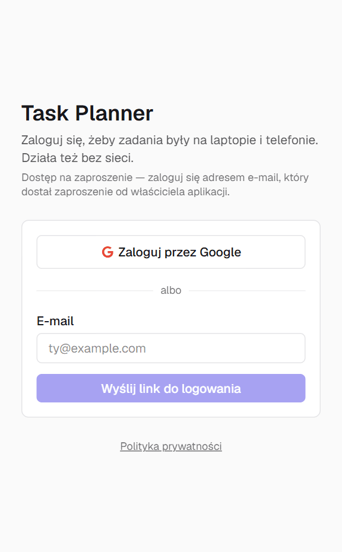\
*Logowanie kontem Google albo linkiem wysłanym na e-mail.*

### Pierwsze uruchomienie

Po pierwszym logowaniu aplikacja pyta o podstawowe ustawienia. Każde z nich zmienisz później w [Ustawieniach](#17-ustawienia).

| Pole | Do czego służy |
| --- | --- |
| Imię, strefa czasowa, pierwszy dzień tygodnia | powitanie, wyznaczanie „dziś”, układ kalendarza |
| Godziny i dni pracy | wolne okna w planie dnia, oś czasu |
| Przypomnienie zadania bez godziny | o której przypominać o zadaniu z samą datą |
| Domyślny czas bloku | długość bloku po przeciągnięciu zadania do kalendarza |
| Przeglądy, tryb skupienia, motyw | patrz odpowiednie rozdziały |
| Przestrzenie na start | np. „Osobiste” i „Praca”; każda dostaje własny Inbox |

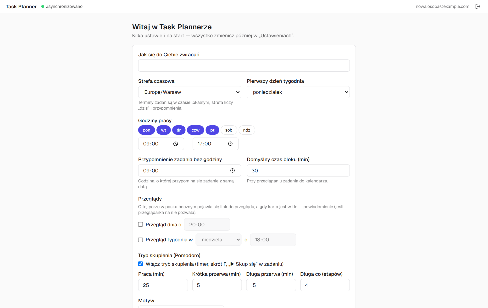\
*Ustawienia przy pierwszym uruchomieniu.*

---

## 2. Okno aplikacji

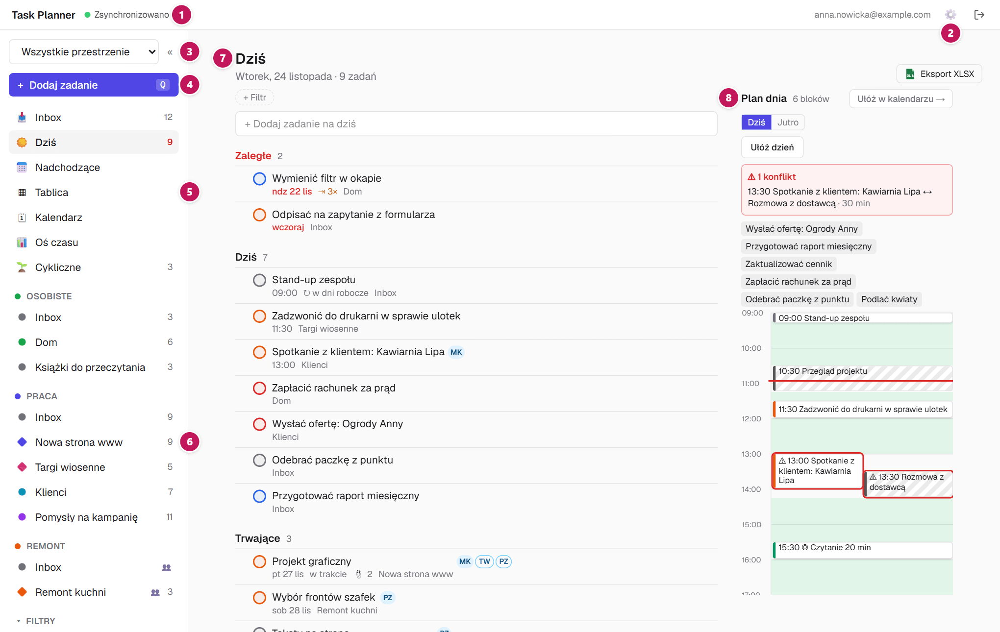\
*Układ okna — widok „Dziś”.*

| Nr | Element | Opis |
| --- | --- | --- |
| 1 | Stan synchronizacji | „Zsynchronizowano”, „Offline — N zmian czeka” albo „Błąd synchronizacji” |
| 2 | ⚙ Ustawienia | obok: wylogowanie |
| 3 | Przełącznik przestrzeni | jedna przestrzeń albo „Wszystkie przestrzenie” |
| 4 | Dodaj zadanie | okno szybkiego dodawania (<kbd>Q</kbd>) |
| 5 | Widoki | Inbox, Dziś, Nadchodzące, Tablica, Kalendarz, Oś czasu, Cykliczne |
| 6 | Listy i projekty | pogrupowane według przestrzeni; niżej filtry, tagi, przeglądy i kosz |
| 7 | Treść widoku | tu pracujesz z zadaniami |
| 8 | Plan dnia | oś godzin na dziś lub jutro |

**Najważniejsze pojęcia**

- **Przestrzeń** — osobny obszar (np. Praca, Dom). Można ją udostępnić innym osobom.
- **Lista** — zbiór zadań. **Projekt** to lista z datą początku i końca oraz statusem.
- **Inbox** — miejsce na rzeczy zapisane w biegu; każda przestrzeń ma swój.
- **Zadanie** może mieć podzadania — do 4 poziomów.

Panel boczny zwiniesz przyciskiem « albo klawiszem <kbd>[</kbd>.

---

## 3. Dodawanie zadań

Naciśnij <kbd>Q</kbd> (w polu tekstowym: <kbd>Ctrl</kbd>+<kbd>Spacja</kbd>) albo kliknij „Dodaj zadanie”. Pola „+ Dodaj…” na górze widoków działają tak samo, a od razu ustawiają listę lub datę.

Wystarczy jedno zdanie — aplikacja sama rozpozna datę, godzinę, listę, priorytet, tagi i przypomnienie:

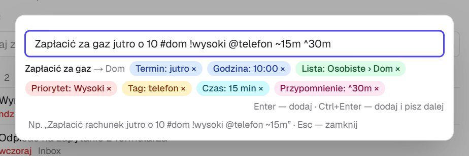\
*Rozpoznane elementy widać jako etykiety pod polem. „×” na etykiecie cofa rozpoznanie.*

| Co | Przykłady zapisu |
| --- | --- |
| Data | `dziś`, `jutro`, `pojutrze`, `za 3 dni`, `w piątek`, `21.11`, `21 lis`, `koniec tygodnia` |
| Godzina | `o 10`, `o 8 wieczorem`, `10-11:30` |
| Czas trwania | `~30m`, `~1h30`, `przez 45 min` |
| Priorytet | `!1` … `!4`, `!krytyczny`, `!wysoki`, `!średni`, `!niski` |
| Lista lub projekt | `#dom`, `#"Remont kuchni"` |
| Tag | `@telefon` |
| Powtarzanie | `codziennie`, `w dni robocze`, `co drugi wtorek`, `ostatniego dnia miesiąca`, `co 3 dni po ukończeniu` |
| Przypomnienie | `przypomnij 15 min przed`, `^15m`, `^9:00` |
| Zwykły tekst | `\jutro` — ukośnik wyłącza rozpoznawanie słowa |

**Przykład:** `Zapłacić za gaz jutro o 10 #dom !wysoki @telefon ~15m ^30m`

Wskazówki:

- <kbd>Enter</kbd> dodaje zadanie i zamyka okno, <kbd>Ctrl</kbd>+<kbd>Enter</kbd> dodaje i zostawia okno na kolejne.
- Wklejenie kilku wierszy tworzy kilka zadań (aplikacja poprosi o potwierdzenie).
- Wklejony adres strony trafia do załączników, a jego tytuł uzupełnia się sam.

Zadania dodasz też z dowolnej strony internetowej — patrz [Dodawanie z innych miejsc](#dodawanie-z-innych-miejsc).

---

## 4. Widoki dnia: Inbox, Dziś, Nadchodzące

### Inbox

Zadania jeszcze nieprzypisane do listy. Najlepiej opróżniać go raz na jakiś czas — pomaga w tym [przegląd tygodnia](#przegląd-tygodnia).

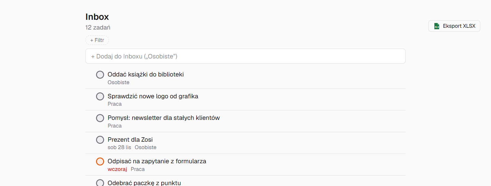\
*Inbox ze wszystkich przestrzeni.*

### Dziś

Wszystko, co wymaga uwagi dzisiaj:

- **Zaległe** — termin już minął; znaczek `⇥ N×` mówi, że zadanie przekładano co najmniej 3 razy,
- **Dziś** — termin na dziś,
- **Trwające** — zadania, których okres (początek–koniec) obejmuje dzisiaj,
- **Cykliczne na dziś** — patrz [Cykliczne](#13-cykliczne),
- **Ukończone** — zrobione dzisiaj.

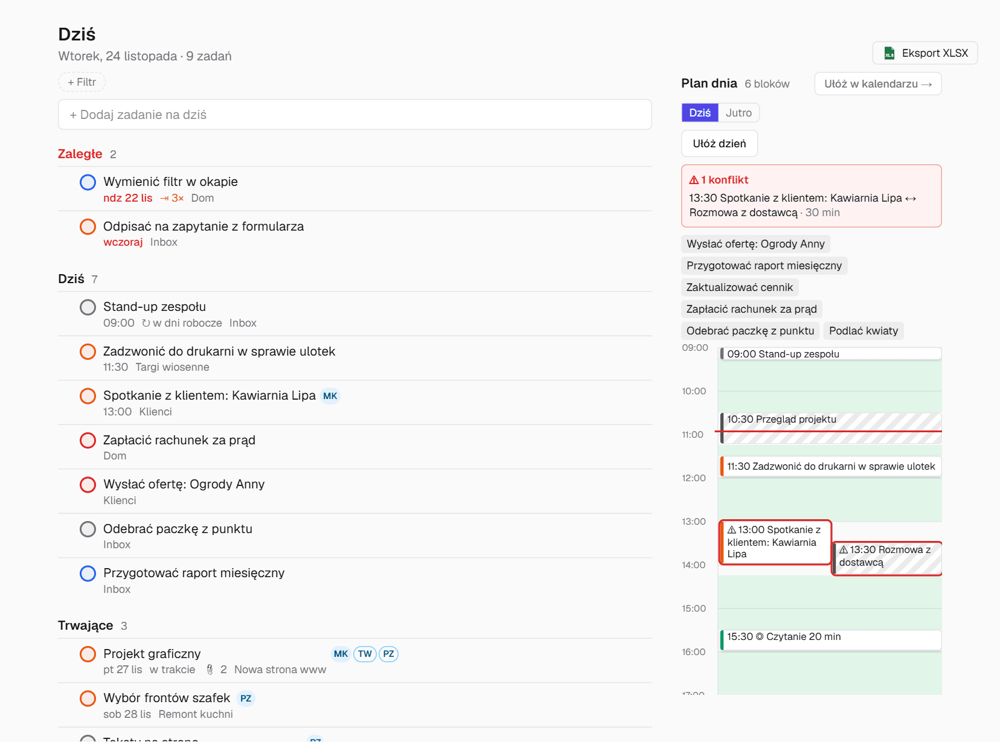\
*„Dziś” z planem dnia po prawej.*

### Plan dnia i „Ułóż dzień”

Panel po prawej pokazuje dzień godzina po godzinie: zadania z godziną, spotkania z [połączonych kalendarzy](#połączone-kalendarze) (kreskowane) i zadania cykliczne. Zielone tło to wolny czas w godzinach pracy, ⚠ — dwie rzeczy naraz. Zadania bez godziny są nad osią.

**Ułóż dzień** proponuje godziny dla zadań, które ich nie mają:

1. Kliknij „Ułóż dzień” i wybierz przerwę między zadaniami.
2. Zobaczysz propozycję — bloki z przerywaną ramką. „✕” na bloku zostawia zadanie bez godziny.
3. Pod „Nie zmieściło się” są zadania bez wolnego okna; „Przełóż na jutro” przesuwa je na następny dzień.
4. „Zastosuj” zapisuje godziny. Do tej chwili nic się nie zmienia, a po zapisaniu możesz kliknąć „Cofnij”.

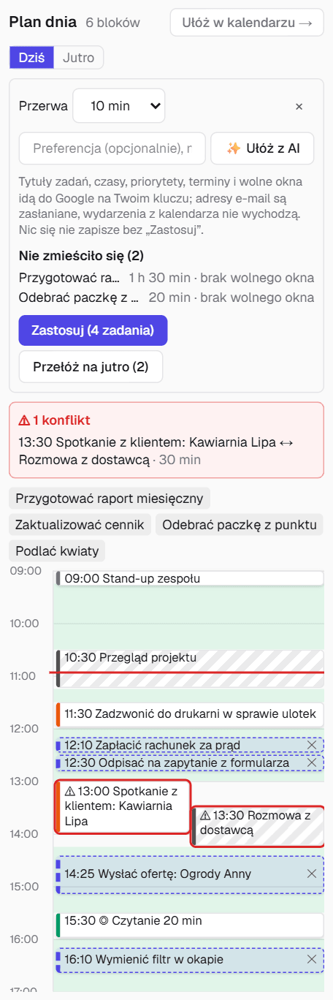\
*Propozycja planu: bloki przerywane to jeszcze niezapisane zadania.*

Układanie działa bez sieci. „✨ Ułóż z AI” wymaga podłączonego [asystenta AI](#asystent-ai).

### Nadchodzące

Najbliższe 14 dni, dalej tygodnie. Zadanie przeciągnięte na inny dzień dostaje nowy termin.

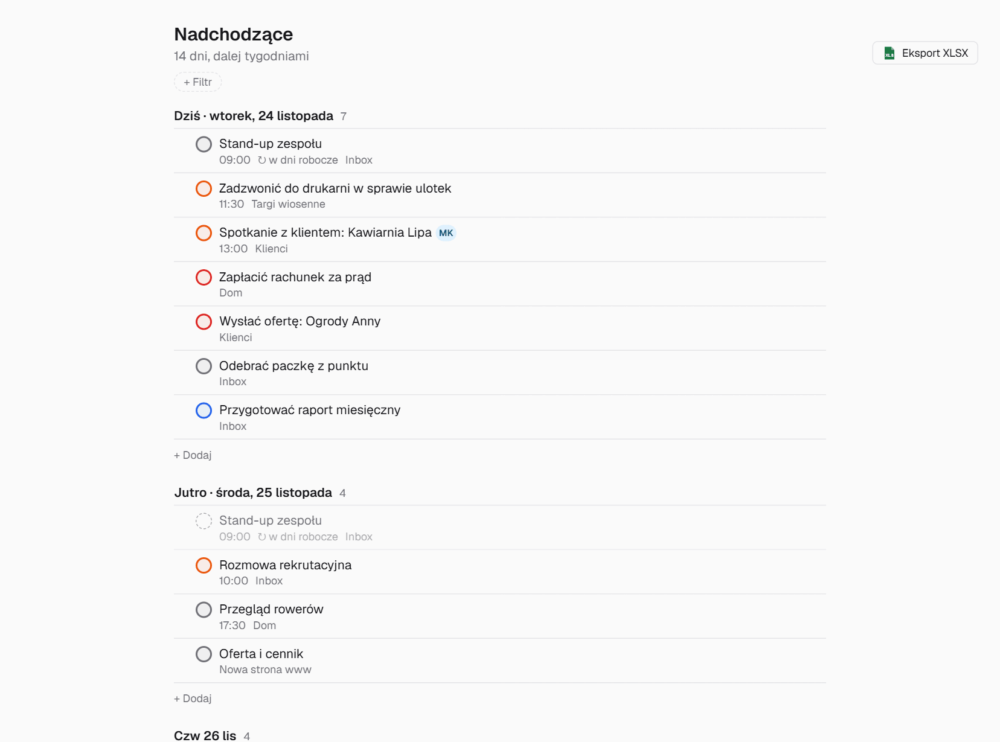\
*Nadchodzące — zadania według dni.*

---

## 5. Praca z zadaniami

### Na liście

- **Ukończenie** — kliknij kółko przy zadaniu albo naciśnij <kbd>E</kbd>. Kolor kółka oznacza priorytet. „Cofnij” w dymku na dole przywraca zadanie.
- **Otwarcie** — kliknij tytuł albo naciśnij <kbd>Enter</kbd>.
- **Kolejność i podzadania** — przeciągnij za uchwyt ⋮⋮ (przy sortowaniu „Ręcznie”). Upuszczone obok podzadania staje się podzadaniem tego samego zadania.

### Wiele zadań naraz

Zaznaczaj przez <kbd>Ctrl</kbd>+klik, <kbd>Shift</kbd>+klik (zakres) albo <kbd>J</kbd> / <kbd>K</kbd> z <kbd>Shift</kbd>. Skróty i paleta działają wtedy na wszystkich zaznaczonych.

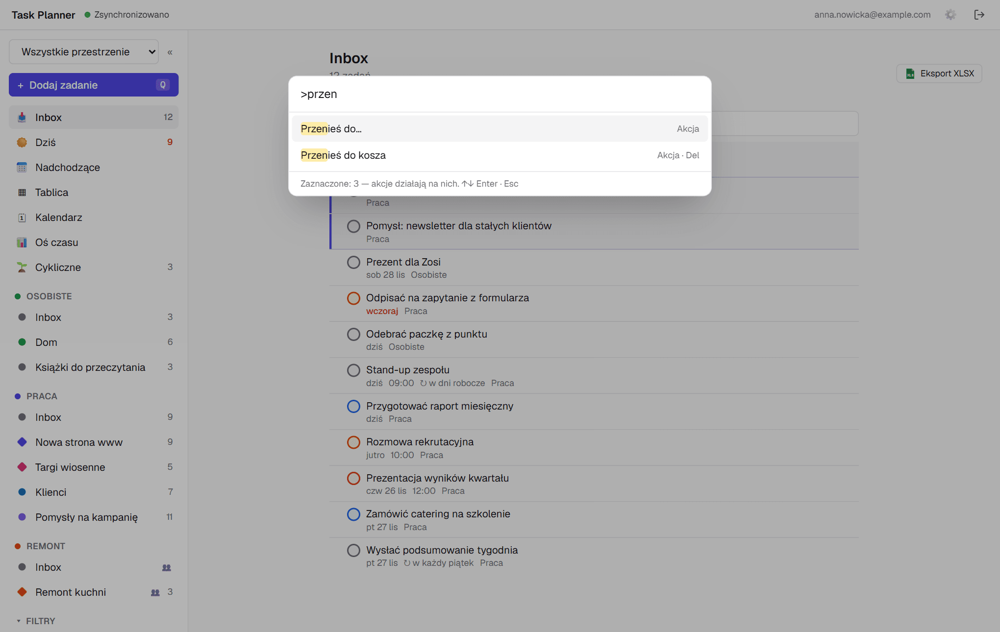\
*Trzy zadania zaznaczone — polecenie z palety wykona się na wszystkich.*

### Paleta i wyszukiwanie

<kbd>Ctrl</kbd>+<kbd>K</kbd> otwiera paletę: znajdziesz w niej zadania, listy, widoki i polecenia. Polskie znaki nie mają znaczenia. Znak `>` na początku ogranicza wyniki do poleceń, a <kbd>/</kbd> otwiera od razu wyszukiwanie.

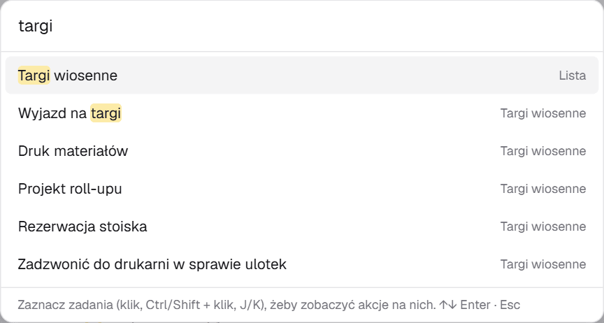\
*Wyszukiwanie w palecie.*

### Statusy i priorytety

| Status | Znaczenie |
| --- | --- |
| Do zrobienia | czeka na swoją kolej |
| W trakcie | praca rozpoczęta |
| Oczekuje | czekasz na kogoś lub na coś; przypomni o tym przegląd tygodnia |
| Gotowe | ukończone |
| Anulowane | już niepotrzebne |

Priorytety: **Krytyczny**, **Wysoki**, **Średni**, **Niski** (klawisze <kbd>1</kbd>–<kbd>4</kbd>).

### Kosz

Usunięte zadania trafiają do kosza na **30 dni**. Do tego czasu można je przywrócić.

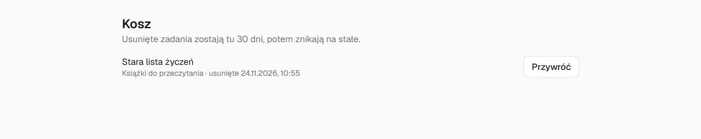\
*Kosz.*

### Eksport do Excela

Przycisk **Eksport XLSX** w nagłówku widoku zapisuje widoczne zadania do arkusza.

---

## 6. Panel zadania

Kliknięcie zadania otwiera panel po prawej. Szerokość zmienisz, przeciągając jego krawędź; ⤢ otwiera pełny widok, <kbd>Esc</kbd> zamyka. Sekcje można zwijać. Zmiany zapisują się same.

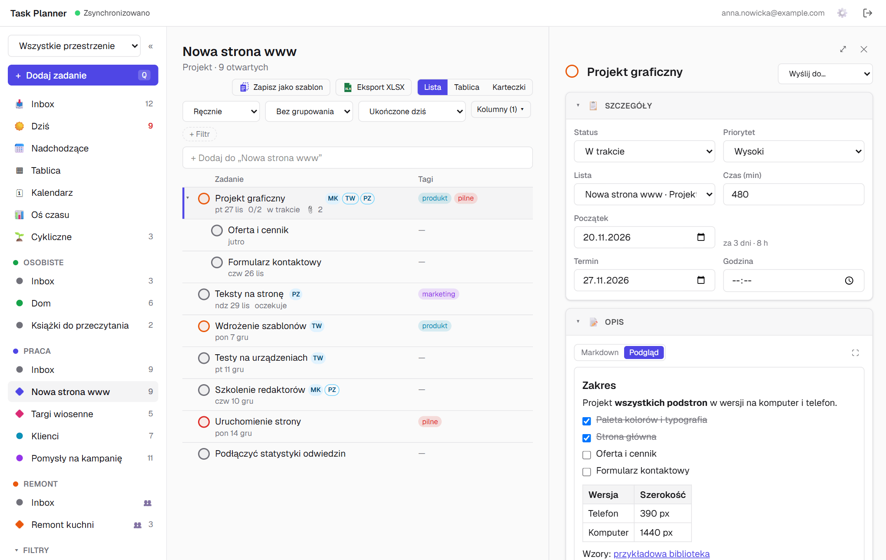\
*Panel zadania obok listy.*

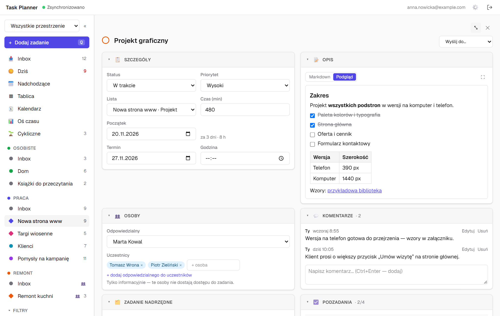\
*To samo zadanie w pełnym widoku.*

**Szczegóły** to status, priorytet, lista, początek, termin z godziną, czas trwania i — na tablicach z własnymi kolumnami — kolumna.

### Opis

Opis zapisuje się w Markdownie: nagłówki, listy, pola wyboru, tabele, linki. „Markdown” to edycja, „Podgląd” — gotowy wygląd, „⛶” — edytor na całym ekranie. Skróty: <kbd>Ctrl</kbd>+<kbd>B</kbd> pogrubienie, <kbd>Ctrl</kbd>+<kbd>I</kbd> kursywa, <kbd>Ctrl</kbd>+<kbd>K</kbd> link.

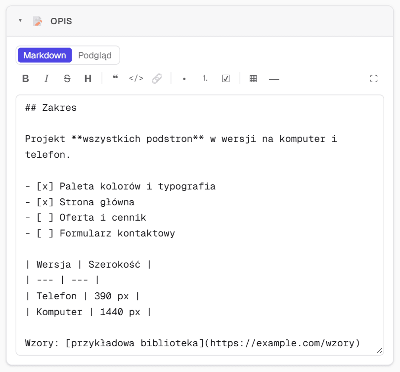\
*Opis z paskiem formatowania.*

### Osoby i komentarze

**Odpowiedzialny** to osoba, która prowadzi zadanie; **uczestnicy** — pozostali zaangażowani. To informacja dla Ciebie: wskazana osoba nie dostaje przez to dostępu ani powiadomienia. Żeby ktoś widział zadanie, [udostępnij przestrzeń](#udostępnianie-przestrzeni).

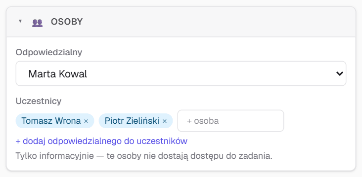\
*Odpowiedzialny i uczestnicy.*

Komentarz wysyła <kbd>Ctrl</kbd>+<kbd>Enter</kbd>.

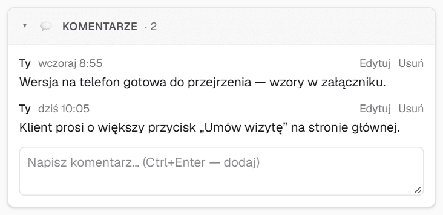\
*Komentarze do zadania.*

### Podzadania

Dodaj nowe albo podepnij istniejące („+ Z istniejących…”). Przy ukończeniu zadania z otwartymi podzadaniami aplikacja zapyta, co z nimi zrobić.

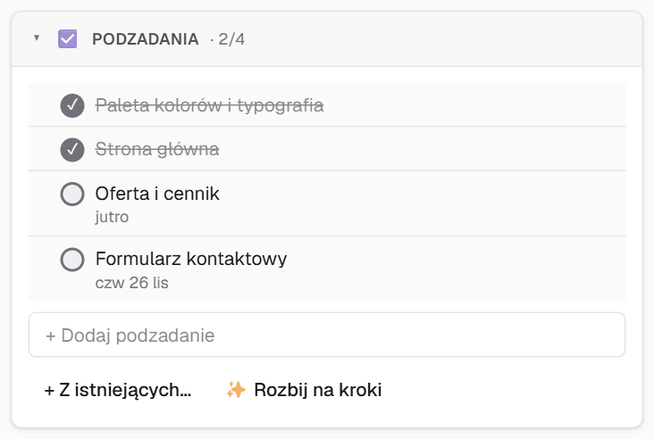\
*Podzadania.*

**✨ Rozbij na kroki** (wymaga [asystenta AI](#asystent-ai)) proponuje do 12 kroków z czasem i datą. Odznacz zbędne, popraw tytuły i dopiero wtedy kliknij „Dodaj” — wcześniej nic się nie zapisuje. „Po poprzednim” łączy kroki zależnością.

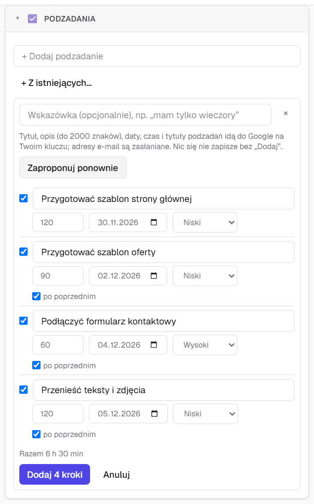\
*Propozycja kroków do sprawdzenia.*

### Zależności

„Czeka na” — zadania, które muszą skończyć się wcześniej; „Blokuje” — zadania czekające na to zadanie. Możesz podać odstęp w dniach. Zależności widać na [osi czasu](#11-oś-czasu) i [karteczkach](#12-karteczki).

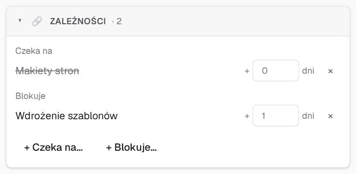\
*Zależności zadania.*

### Tagi

Wpisz nazwę i naciśnij <kbd>Enter</kbd>. Kolejność zmienisz przeciąganiem, kolor — kropką na etykiecie. Pierwszy kolorowy tag decyduje o kolorze karteczki.

### Załączniki

Plik (do 25 MB, razem 250 MB na konto) dodasz przyciskiem, przeciągnięciem lub <kbd>Ctrl</kbd>+<kbd>V</kbd>. Wklejony link dostaje podgląd. Pliki dodane bez sieci wyślą się później.

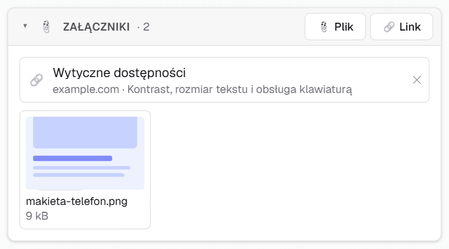\
*Pliki i linki.*

### Przypomnienia

Przypomnienie może być względne („15 min przed terminem”) albo o wybranej porze. Powiadomienia trzeba raz włączyć w [Ustawieniach](#przypomnienia-w-przeglądarce).

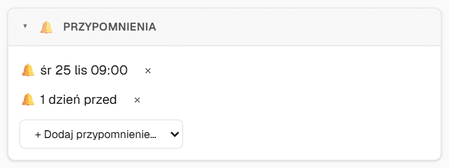\
*Dwa przypomnienia do jednego zadania.*

### Powtarzanie

Wybierz gotową regułę, ustaw szczegóły albo wpisz słowami (np. „co drugi wtorek”). Pod regułą widać najbliższe terminy.

- **Według harmonogramu** — kolejny termin wynika z kalendarza.
- **Po ukończeniu** — kolejny termin liczy się od dnia, w którym zadanie zrobiono.
- „Pomiń to wystąpienie” przechodzi do następnego terminu, „Zakończ serię” kończy powtarzanie.

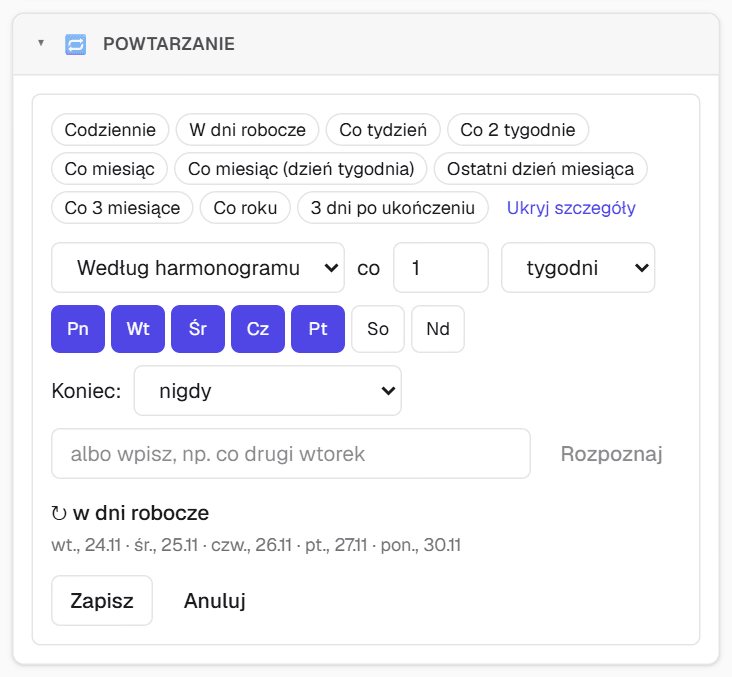\
*Reguła powtarzania z podglądem terminów.*

### Czas pracy, historia, wysyłka

- **Czas pracy** — czas z trybu skupienia i wpisany ręcznie, obok planowanego.
- **Historia zmian** — kto i kiedy co zmienił (wymaga sieci).
- **Wyślij do…** — wysyła zadanie przez [integrację](#integracje).
- **Przenieś do kosza** — usuwa zadanie na 30 dni do kosza.

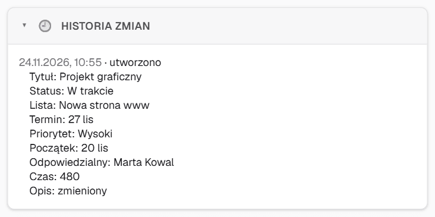\
*Historia zmian zadania.*

---

## 7. Listy i projekty

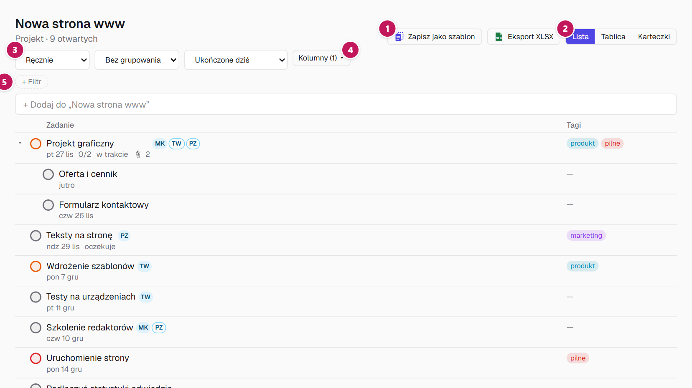\
*Projekt w widoku listy.*

| Nr | Element | Opis |
| --- | --- | --- |
| 1 | Zapisz jako szablon | zapis projektu do ponownego użycia |
| 2 | Lista / Tablica / Karteczki | sposób pokazania tych samych zadań |
| 3 | Sortowanie | Ręcznie, Priorytet, Termin, Data dodania; obok grupowanie i widoczność ukończonych |
| 4 | Kolumny | dodatkowe kolumny po prawej stronie |
| 5 | + Filtr | zawężenie listy |

### Kolumny

Do wyboru: Odpowiedzialny, Początek, Koniec, Tagi (można wskazać, które). Szerokość zmienisz, przeciągając krawędź nagłówka; dwuklik przywraca domyślną.

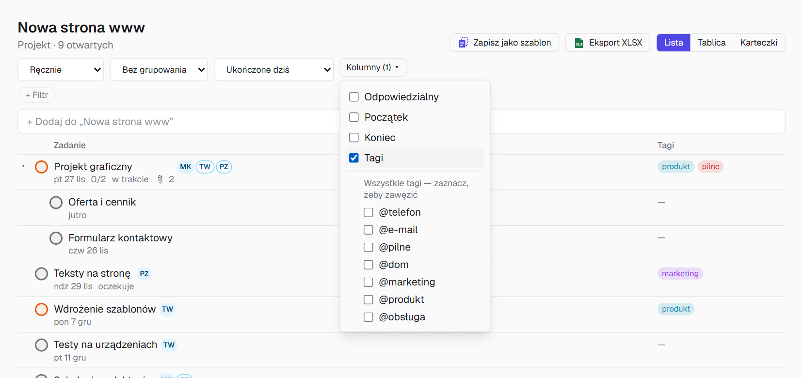\
*Wybór kolumn listy.*

### Grupowanie

Zadania pogrupujesz według priorytetu, listy, terminu, tagu lub statusu.

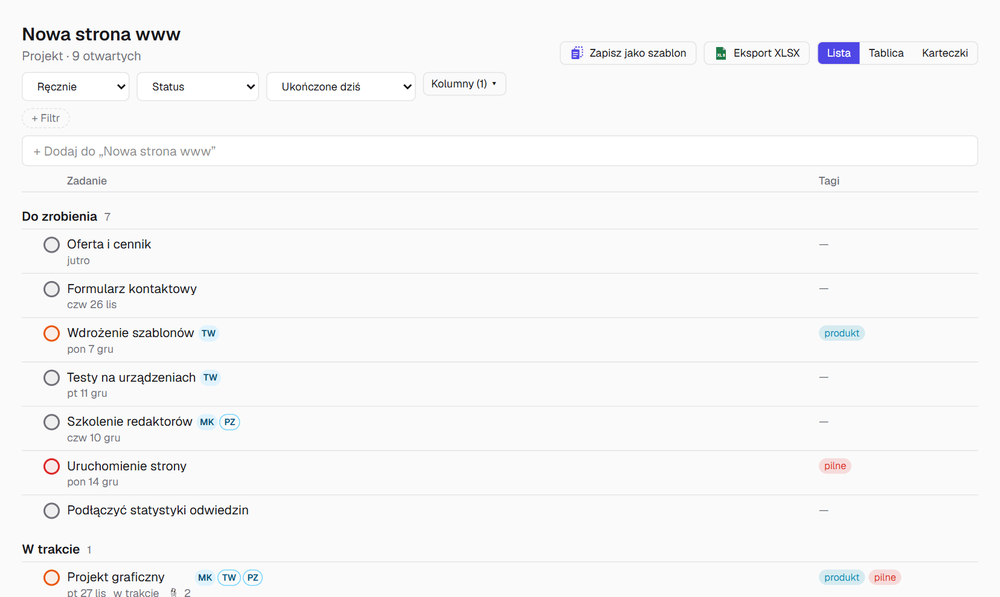\
*Projekt pogrupowany według statusu.*

### Szablony projektów

1. W nagłówku projektu kliknij **Zapisz jako szablon** i podaj nazwę. Ponowny zapis pod tą samą nazwą zastępuje szablon.

   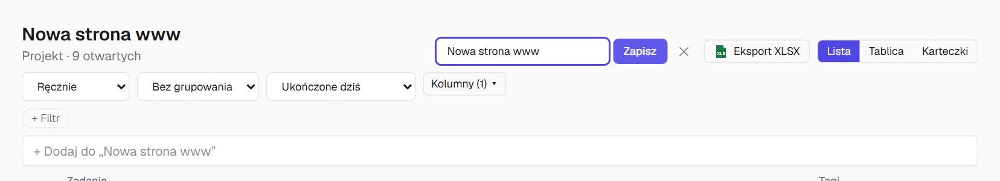\
   *Zapis projektu jako szablonu.*

2. W „Przestrzenie i listy” dodaj nowy projekt, wybierz szablon oraz datę **startu** albo **końca**. Terminy, zależności, podzadania, tagi i przypomnienia przeliczą się same.

   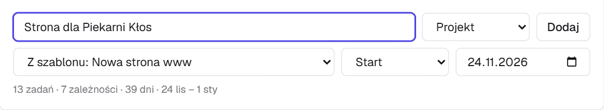\
   *Nowy projekt z szablonu.*

---

## 8. Filtry i tagi

### Filtrowanie

„+ Filtr” zawęża widok według tagu, priorytetu, listy, statusu, osoby, terminu lub godziny. Warunki można łączyć.

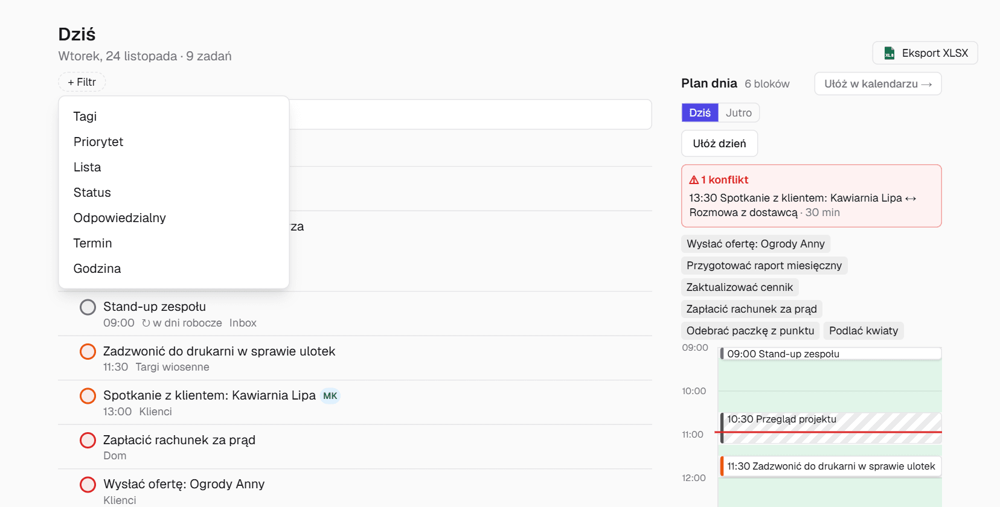\
*Widok z warunkami filtra.*

**Zapisz jako filtr** dodaje zestaw warunków do panelu bocznego.

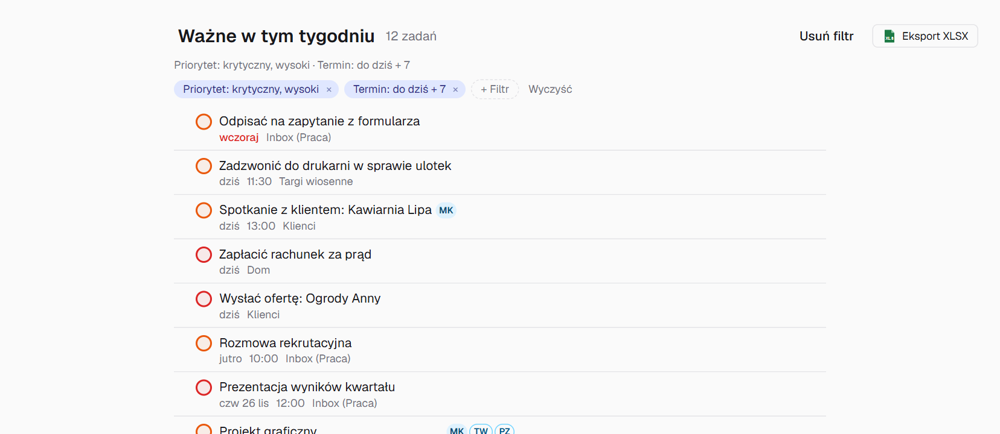\
*Zapisany filtr „Ważne w tym tygodniu”.*

### Tagi

Kliknięcie tagu w panelu bocznym pokazuje wszystkie zadania z tym tagiem. Na górze zmienisz nazwę, kolor i przestrzenie („Widoczny w”), w których tag jest podpowiadany.

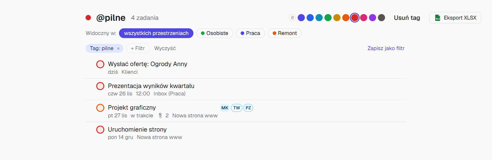\
*Widok tagu.*

---

## 9. Tablica

Tablica układa zadania w kolumnach według **statusu, priorytetu, dnia tygodnia, tagu, listy** lub **własnych kolumn**. Przeciągnięcie karty zmienia odpowiednie pole zadania.

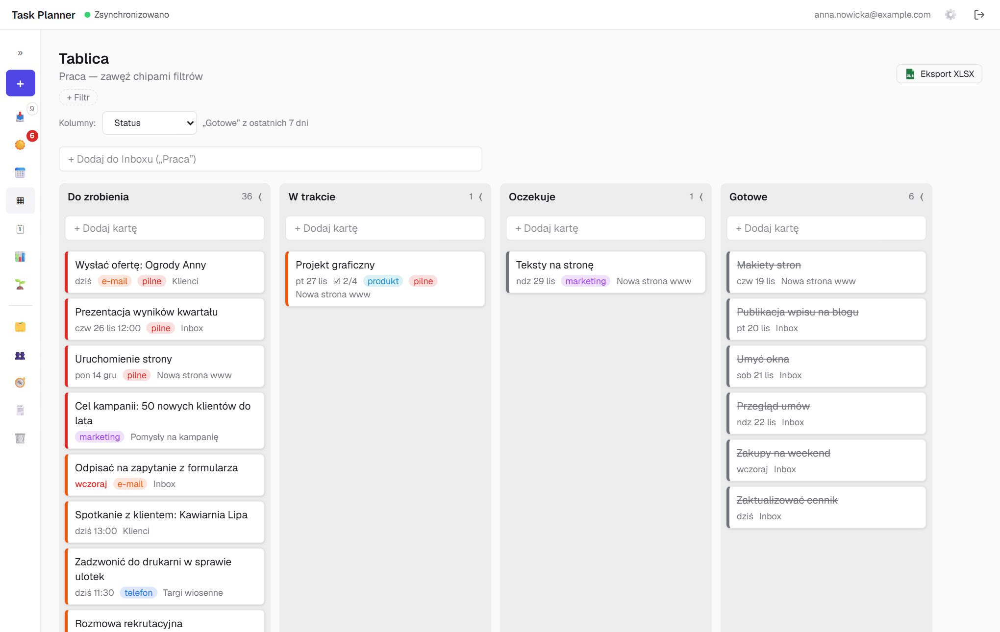\
*Tablica przestrzeni Praca według statusu.*

### Własne kolumny

Każda lista może mieć własne kolumny, np. etapy sprzedaży. Wybierz „Kolumny: Własne”, a potem:

- **+ Kolumna** — dodaje kolumnę,
- ✎ lub dwuklik — zmienia nazwę,
- ✕ — usuwa kolumnę (zadania wracają do „Do przypisania”),
- ⠿ — zmienia kolejność.

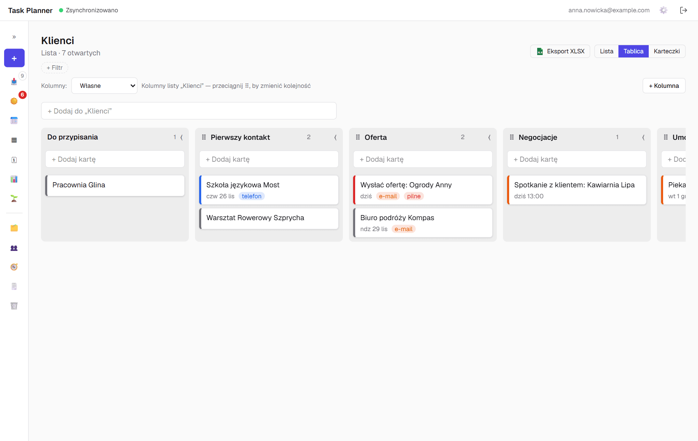\
*Lista „Klienci” z własnymi etapami.*

---

## 10. Kalendarz

Widok dnia, tygodnia lub miesiąca. Po lewej są zadania bez godziny.

- Przeciągnij zadanie z lewej na godzinę — powstaje blok czasu.
- Przeciągnij blok, żeby zmienić termin; dolną krawędź — żeby zmienić długość.
- Przeciągnij blok z powrotem w lewo, żeby usunąć godzinę.

Spotkania z kalendarzy zewnętrznych (kreskowane) i zadania cykliczne są tylko do odczytu. Nakładające się bloki mają czerwoną ramkę.

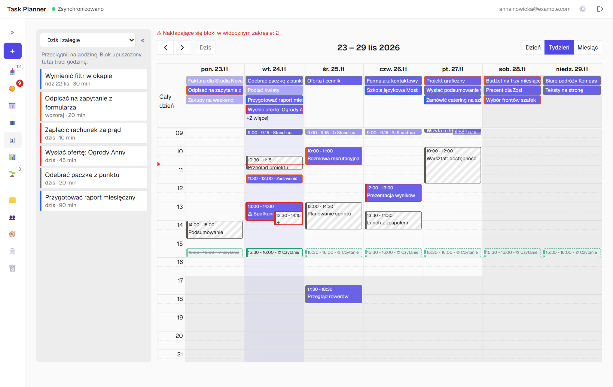\
*Tydzień z zadaniami i spotkaniami.*

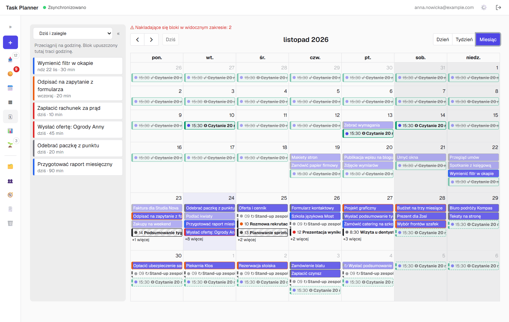\
*Miesiąc.*

---

## 11. Oś czasu

Projekty na osi dni, tygodni lub miesięcy.

- Przeciągnij pasek, żeby zmienić daty, a jego krawędź — żeby zmienić początek lub koniec.
- Przeciągnij koniec paska na inny pasek, żeby dodać zależność. Kliknięcie strzałki ją usuwa.
- **Przesuń zależne** — zmiana terminu przesuwa też zadania, które na nie czekają.
- **Bez terminu** — pokazuje też zadania bez dat.
- **Projekty** — wybór widocznych projektów; **Eksport XLSX** zapisuje oś do arkusza.

Gdy zadanie zaczyna się przed końcem poprzednika, na górze pojawia się ostrzeżenie z przyciskiem „Popraw”.

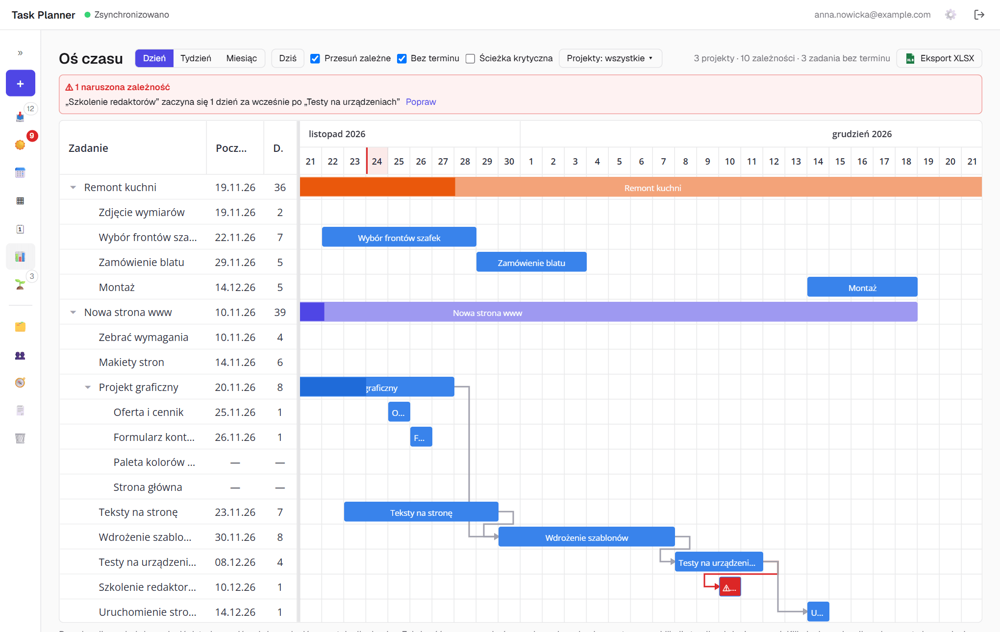\
*Oś czasu z naruszoną zależnością (czerwony pasek).*

### Ścieżka krytyczna

Zaznaczenie **Ścieżka krytyczna** wyróżnia na pomarańczowo zadania, których opóźnienie przesunie koniec projektu. Kolumna „Zapas” mówi, o ile dni roboczych można opóźnić pozostałe.

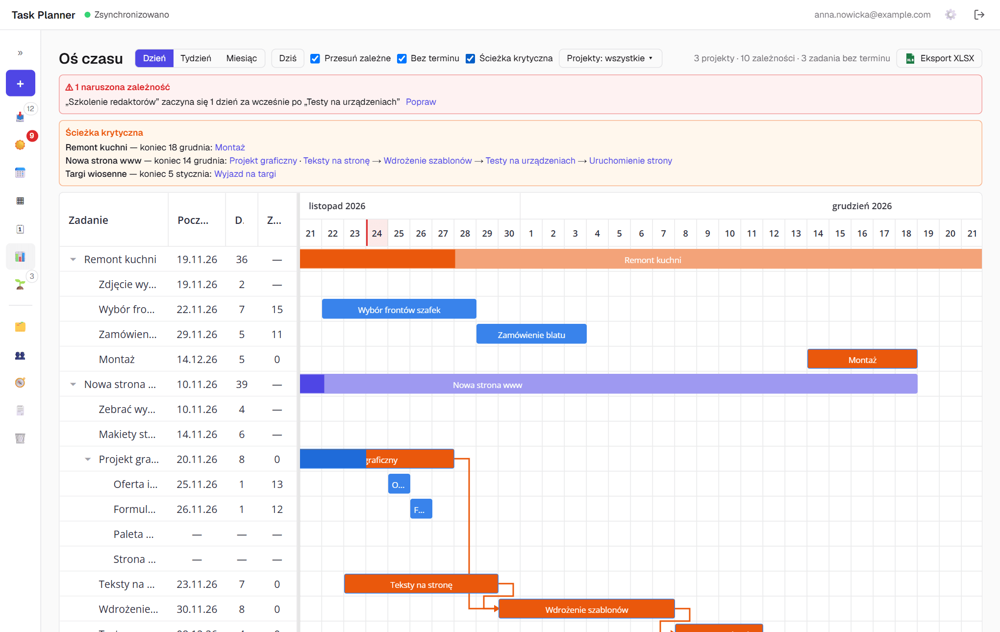\
*Ścieżka krytyczna projektów.*

---

## 12. Karteczki

Trzeci widok listy — swobodna tablica do burzy mózgów i planowania. Zadania są kartkami na siatce; nowe czekają w pasku **Do ułożenia**. Układanie wymaga sieci.

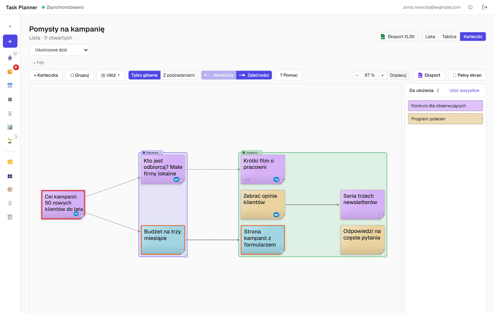\
*Karteczki z grupami i strzałkami.*

| Chcesz… | Zrób to |
| --- | --- |
| dodać kartkę | dwuklik w puste miejsce albo <kbd>N</kbd> |
| przesunąć | przeciągnij albo użyj strzałek |
| zaznaczyć wiele | <kbd>Shift</kbd>+przeciąganie, <kbd>Ctrl</kbd>+<kbd>A</kbd> |
| połączyć kartki | przeciągnij ● na inną kartkę i wybierz **blokuje** (<kbd>B</kbd>) albo **wynika z** (<kbd>W</kbd>) |
| usunąć strzałkę | kliknij ją i naciśnij <kbd>Delete</kbd> |
| przesunąć tablicę | przeciągnij tło, użyj kółka albo <kbd>Spacja</kbd>+przeciąganie |
| powiększyć | <kbd>Ctrl</kbd>+kółko, <kbd>+</kbd>, <kbd>−</kbd>, <kbd>0</kbd> (100 %); „Dopasuj” pokazuje całość |
| otoczyć ramką | zaznacz kartki i kliknij „Grupuj” |

**Blokuje** to prawdziwa zależność (widać ją też na osi czasu), **wynika z** — tylko powiązanie myśli. Kolor kartki pochodzi od pierwszego kolorowego tagu, ramka — od priorytetu. „Z podzadaniami” pokazuje także podzadania, „Hierarchia” i „Zależności” włączają linie.

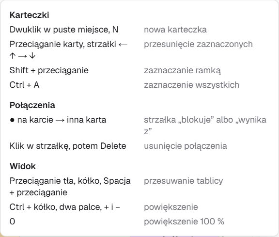\
*Ściąga pod przyciskiem „? Pomoc”.*

### Automatyczne układanie

**Ułóż** porządkuje kartki według koloru, priorytetu, osoby, statusu, terminu, strzałek lub hierarchii; „Zagęść” usuwa puste miejsca. Po najechaniu na opcję widać podgląd, a po wybraniu działa „Cofnij”.

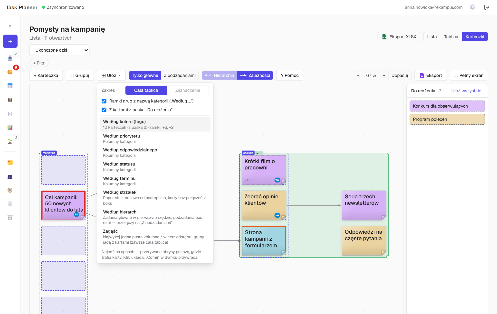\
*Podgląd układu według koloru.*

### Eksport PNG i PDF

Przycisk **Eksport** zapisuje tablicę lub zaznaczenie do pliku — z legendą kolorów, na A4 lub A3, na jednej lub kilku stronach.

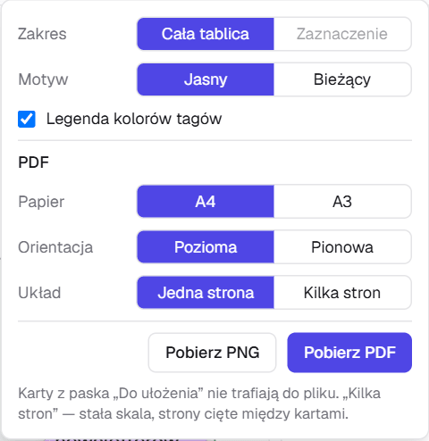\
*Ustawienia eksportu.*

---

## 13. Cykliczne

Czynności, w których liczy się regularność: woda, siłownia, nauka. W odróżnieniu od zadania z powtarzaniem mają passę (liczbę kolejnych zaliczonych dni lub okresów), statystyki i mapę roku.

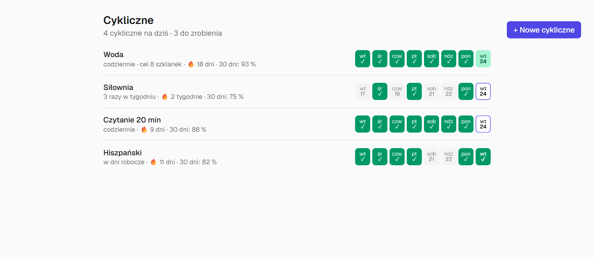\
*Lista cyklicznych z ostatnimi dniami.*

Kliknięcie dnia zmienia jego stan: **zrobione → dzień wolny → puste**. Uzupełnić można do 7 dni wstecz. Przy celu ilościowym (np. 8 szklanek) dodajesz kolejne porcje przyciskiem „+” w widoku „Dziś”.

### Dodawanie

Harmonogram: **Codziennie**, **W wybrane dni**, **Co miesiąc** albo **N razy w okresie**. Opcjonalnie: cel ilościowy, pora (blok pojawi się w kalendarzu), koniec i przypomnienia.

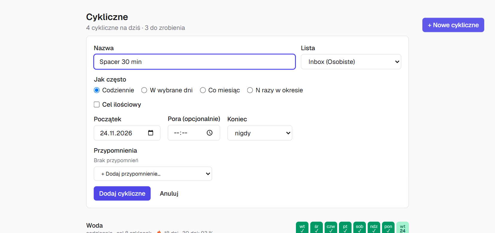\
*Nowe cykliczne.*

### Statystyki

Po kliknięciu nazwy zobaczysz bieżącą i najdłuższą passę, regularność, wykres tygodni i mapę roku. Tu też zmienisz, zakończysz, wznowisz lub usuniesz cykliczne.

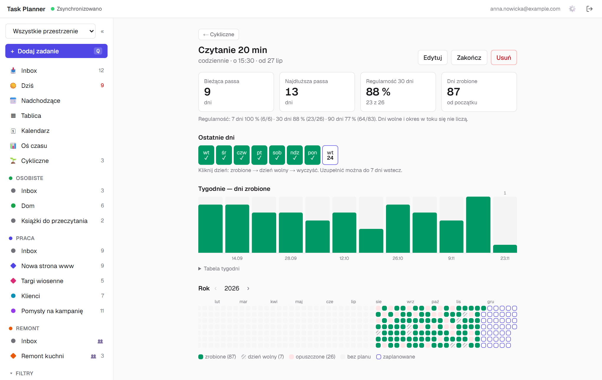\
*Statystyki „Czytanie 20 min”.*

---

## 14. Tryb skupienia

Zaznacz zadanie i naciśnij <kbd>F</kbd> albo kliknij „▶ Skup się”. Do wyboru Pomodoro (domyślnie 25 min pracy, 5 min przerwy, po 4 etapach 15 min) lub stoper. <kbd>Spacja</kbd> wstrzymuje i wznawia.

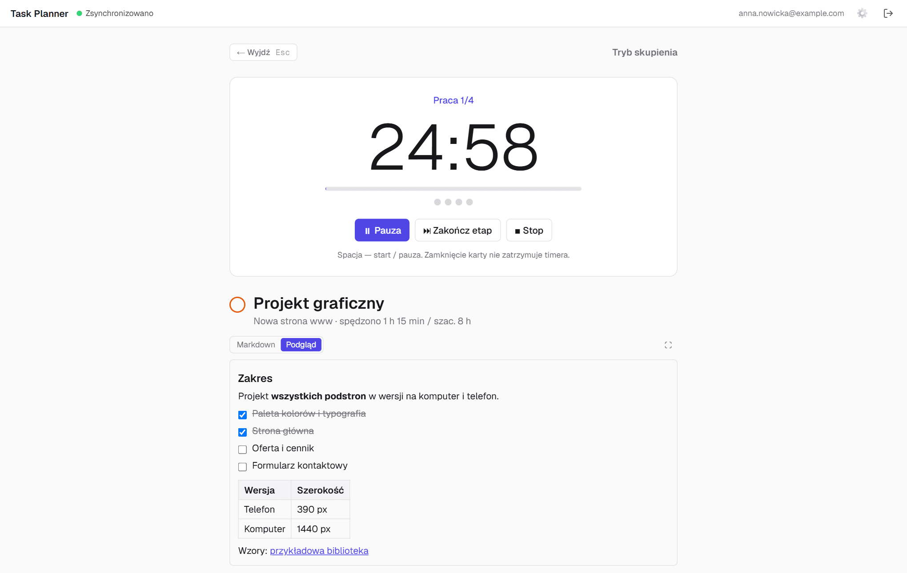\
*Skupienie na zadaniu „Projekt graficzny”.*

Zamknięcie karty nie zatrzymuje zegara, a przerwany etap dokończysz na innym urządzeniu. Czas dolicza się do zadania. Tryb można wyłączyć w Ustawieniach.

---

## 15. Przeglądy

Przeglądy włączasz i ustawiasz w Ustawieniach → Przeglądy; o wybranej porze w panelu bocznym pojawi się przypomnienie.

### Przegląd dnia

Aplikacja pokazuje po jednym zadaniu na dziś i zaległym. Decyzja to jeden klawisz:

| Klawisz | Decyzja |
| --- | --- |
| <kbd>1</kbd> | Ukończ |
| <kbd>2</kbd> | Dziś |
| <kbd>3</kbd> | Jutro |
| <kbd>4</kbd> | Wybierz datę |
| <kbd>5</kbd> | Kiedyś (bez terminu) |
| <kbd>6</kbd> | Usuń |
| <kbd>→</kbd> / <kbd>Spacja</kbd> | pomiń |
| <kbd>←</kbd> | wróć |

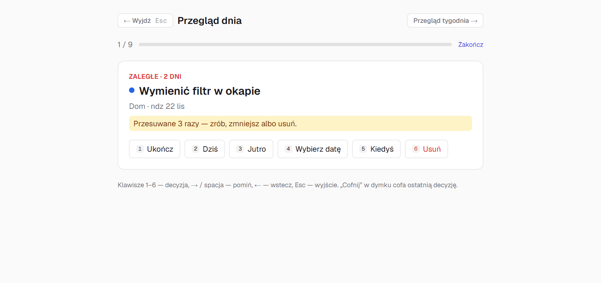\
*Zadanie przekładane kilka razy ma podpowiedź.*

Na końcu jest podsumowanie oraz plan na dziś i jutro.

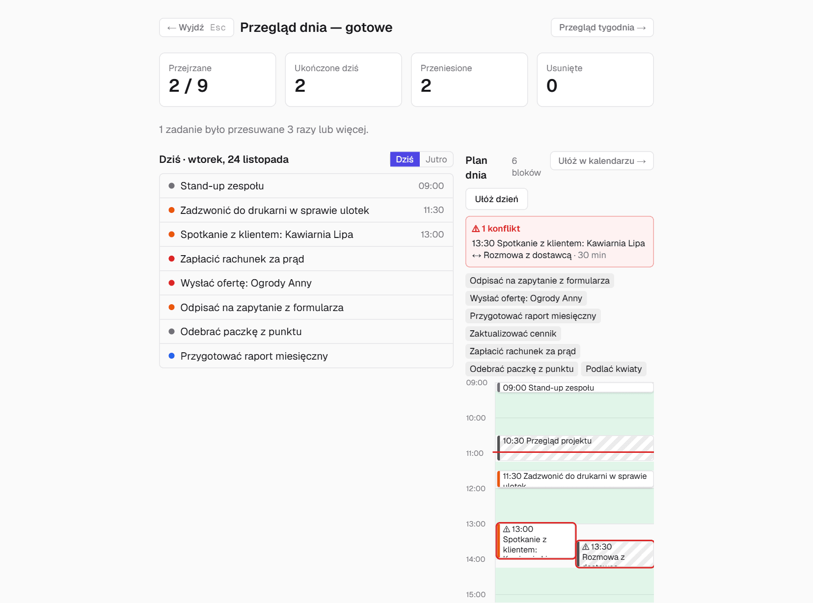\
*Koniec przeglądu dnia.*

### Przegląd tygodnia

Siedem kroków: Inbox do zera → Zaległe → Projekty bez następnego kroku → Oczekuje > 7 dni → Nadchodzący tydzień → Cykliczne w tygodniu → Podsumowanie.

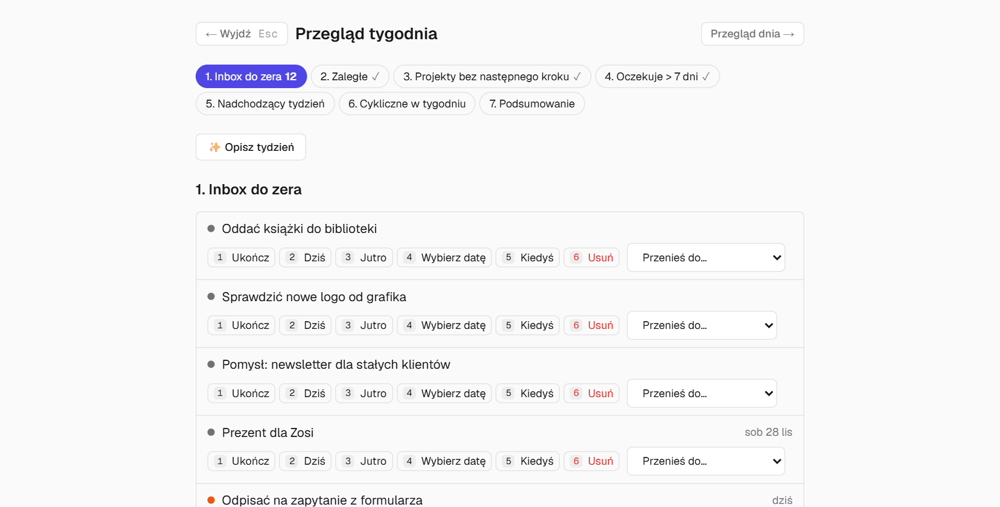\
*Krok 1 — Inbox do zera.*

Podsumowanie zbiera liczby z tygodnia. „✨ Opisz tydzień” (wymaga [asystenta AI](#asystent-ai)) dopisuje krótki komentarz i sugestie, które działają dopiero po kliknięciu.

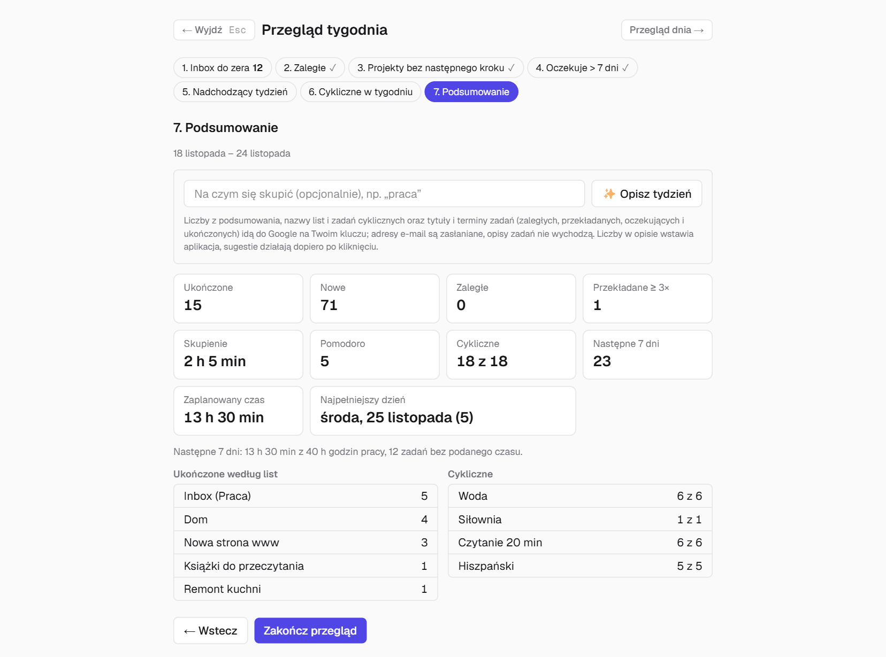\
*Krok 7 — Podsumowanie.*

---

## 16. Przestrzenie i udostępnianie

### Przestrzenie i listy

W panelu bocznym → **Przestrzenie i listy** dodajesz, nazywasz, kolorujesz, porządkujesz i archiwizujesz przestrzenie, listy i projekty.

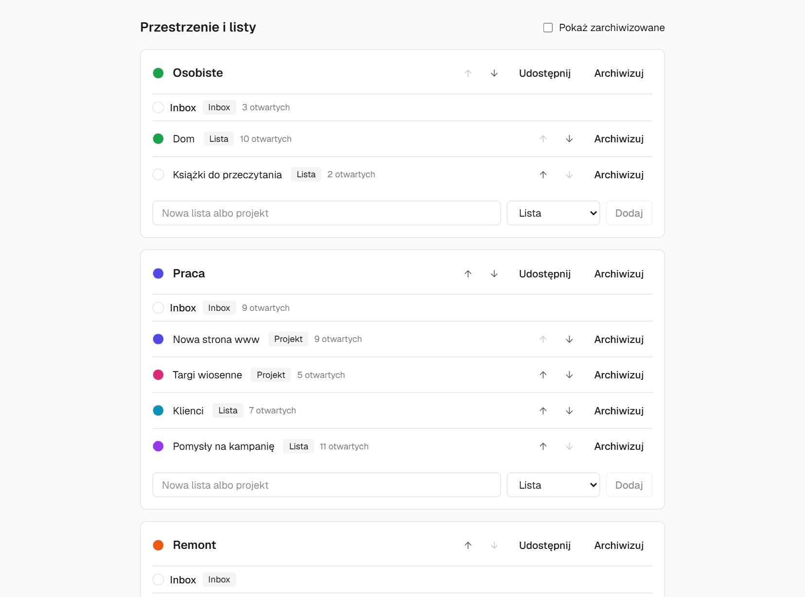\
*Zarządzanie przestrzeniami.*

### Udostępnianie przestrzeni

1. Przy przestrzeni kliknij **Udostępnij**.
2. Wpisz e-mail i wybierz rolę: **Edytor** (dodaje i zmienia) albo **Podgląd** (tylko czyta). Osoba musi mieć konto albo zaproszenie do aplikacji.
3. Wyślij skopiowany link — jest ważny 14 dni. Zaproszenie pojawi się też u tej osoby po zalogowaniu.

\
*Osoby w przestrzeni i dostęp do list.*

\
*Zaproszenie widoczne po zalogowaniu.*

**Dostęp do list** pozwala ukryć listę przed gośćmi lub dać im tylko podgląd. Liczy się słabsze z dwóch: rola osoby i ustawienie listy. Ikony przy nazwach list:

| U właściciela | U gościa |
| --- | --- |
| 👥 goście mogą edytować | ✎ możesz edytować |
| 👁 goście mają podgląd | 👁 tylko podgląd |
| 🔒 lista ukryta | — (listy nie widać) |

Przestrzeń może usunąć tylko właściciel; gość może ją opuścić. Przypomnienia dostaje wyłącznie ten, kto je ustawił.

### Współpracownicy

Osoby, które wskazujesz jako odpowiedzialne lub uczestników. Każda ma imię, opcjonalny e-mail i akronim (do 5 znaków) widoczny przy zadaniu. Niżej są osoby z udostępnionych przestrzeni.

\
*Współpracownicy.*

---

## 17. Ustawienia

Otwórz je ikoną ⚙ w nagłówku. Pierwsza część to te same pola co przy [pierwszym uruchomieniu](#pierwsze-uruchomienie).

\
*Ustawienia podstawowe.*

### Przypomnienia w przeglądarce

Kliknij „Włącz powiadomienia” i zezwól na nie w przeglądarce. Przypomnienia przychodzą także przy zamkniętej karcie. Ustawienie dotyczy każdej przeglądarki osobno.

\
*Karta „Przypomnienia”.*

### Połączone kalendarze

- **Google** — spotkania widać w kalendarzu i planie dnia. Zadania z godziną mogą też trafiać do osobnego kalendarza „Task Planner” w Google — zmiana tam zmienia zadanie.
- **Adres ICS** — dowolny kalendarz udostępniony linkiem, tylko do odczytu.

Nie podłączaj tego samego kalendarza przez Google i ICS — spotkania będą podwójne.

\
*Połączony kalendarz ICS.*

### Integracje

Wysyłają zadania do innych narzędzi: **webhook** (np. n8n, Make) lub **GitLab** (issue). Najpierw dodaj połączenie, potem regułę:

- **ręczna** — pozycja „Wyślij do…” w zadaniu,
- **zdarzeniowa** — wysyła sama, np. po dodaniu tagu. Krótkie opóźnienie pozwala cofnąć pomyłkę przed wysłaniem.

„Po udanej wysyłce zmień zadanie” może dodać lub usunąć tag albo zmienić status. Nieudaną wysyłkę ponowisz w historii.

\
*Połączenia, reguły i historia wysyłek.*

\
*Reguła: tag „produkt” tworzy issue w GitLabie.*

### Asystent AI

Funkcje ✨ korzystają z **Twojego** klucza Gemini (Google). Wklej klucz z projektu z włączonymi płatnościami, potwierdź to i kliknij „Sprawdź”, a potem wybierz model. Do Google trafiają tylko dane potrzebne do odpowiedzi; adresy e-mail są zasłaniane. Asystent niczego nie zapisuje bez Twojego kliknięcia.

\
*Podłączony asystent.*

### Kopia zapasowa

„Eksportuj do pliku” zapisuje dane w JSON (bez plików załączników i połączonych kalendarzy). „Importuj z pliku…” przywraca je — powtórny import niczego nie podwaja.

\
*Kopia zapasowa.*

### Dodawanie z innych miejsc

Przeciągnij przycisk na pasek zakładek. Kliknięty na dowolnej stronie otwiera szybkie dodawanie z jej tytułem i adresem. Na telefonie z Androidem działa „Udostępnij” → Task Planner.

\
*Zakładka i udostępnianie.*

### Aplikacja na pulpicie

Chrome i Edge instalują Task Planner jak zwykły program — z ikoną i własnym oknem.

\
*Instalacja aplikacji.*

### Motyw

Jasny, ciemny lub zgodny z systemem.

\
*„Dziś” w motywie ciemnym.*

### Usunięcie konta

Usuwa konto i wszystkie dane z serwera; przestrzenie, które udostępniasz, znikną też u innych osób. **Nie da się tego cofnąć** — najpierw zrób kopię zapasową.

\
*Usunięcie konta wymaga wpisania adresu e-mail.*

---

## 18. Praca bez sieci

Bez internetu możesz dalej dodawać, zmieniać i planować zadania. Stan widać w nagłówku:

\
*Zmiany czekają na wysłanie.*

Po odzyskaniu połączenia wyślą się same. Jeśli to samo pole zmieniono na dwóch urządzeniach, zostaje późniejsza zmiana. Zanim pierwszy raz pojedziesz bez zasięgu, otwórz aplikację raz z siecią i sprawdź kartę **Praca bez sieci** — znajdziesz tam też listę rzeczy, które wymagają połączenia.

\
*Karta „Praca bez sieci” w Ustawieniach.*

---

## 19. Na telefonie i w wąskim oknie

W wąskim oknie panel boczny chowa się pod przycisk **Menu** w prawym dolnym rogu. Na Androida jest też osobna aplikacja — korzysta z tego samego konta i tych samych danych.

 \
*„Dziś” w wąskim oknie i otwarte menu.*

---

## 20. Skróty klawiszowe

Listę w aplikacji otwiera <kbd>?</kbd>. Skróty jednoklawiszowe nie działają w polach tekstowych.

| Skrót | Działanie |
| --- | --- |
| <kbd>G</kbd> <kbd>I</kbd> / <kbd>T</kbd> / <kbd>U</kbd> | Inbox / Dziś / Nadchodzące |
| <kbd>G</kbd> <kbd>K</kbd> / <kbd>C</kbd> / <kbd>O</kbd> / <kbd>H</kbd> | Tablica / Kalendarz / Oś czasu / Cykliczne |
| <kbd>Q</kbd>, <kbd>Ctrl</kbd>+<kbd>Spacja</kbd> | szybkie dodawanie (drugi także w polu tekstowym) |
| <kbd>E</kbd> | ukończ |
| <kbd>1</kbd>–<kbd>4</kbd> | priorytet |
| <kbd>T</kbd> / <kbd>M</kbd> / <kbd>D</kbd> | na dziś / na jutro / wybierz datę |
| <kbd>Del</kbd> | przenieś do kosza |
| <kbd>F</kbd> | tryb skupienia |
| <kbd>/</kbd>, <kbd>Ctrl</kbd>+<kbd>K</kbd> | szukaj, paleta poleceń |
| <kbd>J</kbd> / <kbd>K</kbd> | następne / poprzednie zadanie |
| <kbd>Shift</kbd>+<kbd>J</kbd> / <kbd>K</kbd> | rozszerz zaznaczenie |
| <kbd>Ctrl</kbd>+klik, <kbd>Shift</kbd>+klik | dodaj do zaznaczenia, zaznacz zakres |
| <kbd>Enter</kbd> / <kbd>Esc</kbd> | otwórz zadanie / zamknij panel lub odznacz |
| <kbd>[</kbd> | zwiń lub rozwiń panel boczny |

\
*Lista skrótów w aplikacji.*

---

## 21. Pytania i odpowiedzi

**Nie mogę założyć konta.**\
Konta są na zaproszenie. Poproś osobę zarządzającą aplikacją o dodanie Twojego adresu.

**Link do logowania nie działa.**\
Otwórz go w tej samej przeglądarce, z której wysłano prośbę o link. Jeśli wygasł, wyślij nowy.

**Nie widzę zmian z drugiego urządzenia.**\
Sprawdź stan w nagłówku obu urządzeń. „Offline” oznacza, że zmiany czekają na połączenie.

**Pasek mówi, że aplikacja jest otwarta w starszej wersji.**\
Zamknij pozostałe karty z Task Plannerem i odśwież stronę.

**Przypomnienia nie przychodzą.**\
Włącz je w Ustawieniach → Przypomnienia, sprawdź uprawnienia strony w przeglądarce i tryb „Nie przeszkadzać” w systemie.

**Nie widać funkcji ✨.**\
Podłącz i sprawdź klucz w Ustawieniach → Asystent AI.

**Nie mogę edytować zadania.**\
Masz rolę „Podgląd” albo lista jest udostępniona tylko do podglądu. Poproś właściciela przestrzeni o zmianę.

**Coś usunięto przez pomyłkę.**\
Kliknij „Cofnij” w dymku na dole, a później — przywróć z Kosza (30 dni).

**Czy wylogowanie usuwa dane?**\
Nie. Dane zostają na serwerze, a niewysłane zmiany — w tej przeglądarce do następnego logowania (aplikacja o nich ostrzeże).
